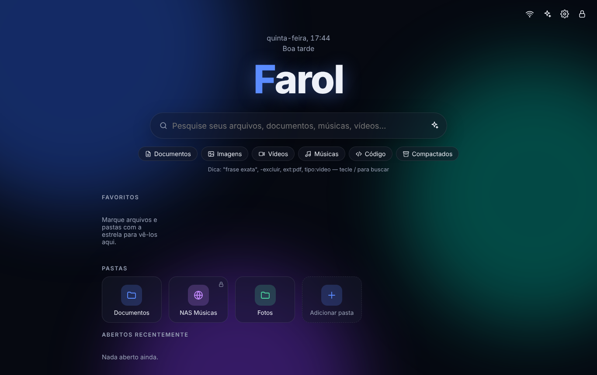
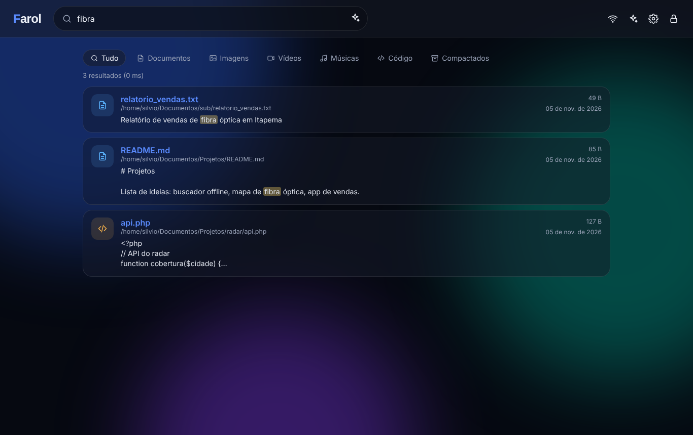

<p align="center"></p>

<h1 align="center">Farol</h1>
<p align="center"><b>Your offline "Google": search, open, play and edit everything on your computer — no internet, no cloud, no tracking.</b></p>
<p align="center"><a href="README.md">🇧🇷 Português</a> · 🇺🇸 English · <a href="README.es.md">🇪🇸 Español</a></p>

<p align="center"> </p>

## ✨ Features

- 🔎 **Search by file name and by content** — TXT, MD, source code, PDF, DOCX, XLSX, PPTX, ODT, EPUB, HTML, CSV… Accent-insensitive, highlighted snippets, millisecond results (SQLite FTS5 + BM25).
- 🧠 **Google-style operators** — `"exact phrase"`, `-exclude`, `ext:pdf`, `kind:video` / `kind:music` / `kind:image` / `kind:code`.
- 🎬 **Video player** with instant seeking (HTTP Range streaming) · 🎵 **Music player** with queue, docked at the bottom.
- 📄 **Viewer** for PDF, images (zoom) and Office/LibreOffice text · ✏️ **Source code editor** (line numbers, Ctrl+S, automatic backups).
- ⭐ **Favorites & recent files** on the home screen.
- 🎨 **Fully customizable** — light/dark/auto theme, accent color, animated backgrounds, **your own wallpaper**, per-folder colors, glass/solid/outline tiles, fonts, density, custom logo text and greeting.
- 🌐 **Network folders** (SMB/NFS, NAS, `\\server\share`, mapped drives) with **read-only** option.
- 📡 **Network panel** — who is **connected to Farol** (IP, browser, last seen, kick) and **devices on your LAN** (IP, MAC, name, router).
- 🤖 **Optional AI** — **Claude**, **ChatGPT**, **Ollama (local, offline)**, LM Studio or any OpenAI-compatible API. It searches your files and **cites sources**.
- 🖥️ **Dev Mode (off by default)** — in-browser terminal (local shell) and saved **SSH** connections. Requires the password to enable.
- 🌍 **3 languages** — Português, English, Español.
- 🔐 **Secure** — password set at install time (no default), PBKDF2 600k iterations, brute-force lockout, CSRF protection, CSP, file sandboxing, no access outside configured folders.

## 🚀 Install

Only requirement: **Python 3.9+**.

| System | How |
|---|---|
| **Windows** | Download ZIP → double-click `install.bat` → set your password → "Farol" shortcut on the Desktop |
| **Linux / macOS** | `./install.sh` then `./farol.sh` |
| **Linux server (systemd)** | `sudo ./install.sh --server` — see [docs/SERVIDOR.md](docs/SERVIDOR.md) for HTTPS |
| **Docker** | `FAROL_PASSWORD='strongPass' docker compose up -d` |
| **Manual** | `pip install -r requirements.txt && python -m farol setup && python -m farol run` |

## ⌨️ Shortcuts

`/` or `Ctrl+K` search · `Esc` close · `Ctrl+S` save in editor · `Space` play/pause music

## 🛠️ CLI

```bash
python -m farol setup [--server] [--lang pt-BR|en|es] [--root DIR] [--port N] [--password-stdin]
python -m farol run [--no-browser] [--cert cert.pem --key key.pem] [--proxy]
python -m farol passwd | add-root DIR [--readonly] | index | dev --on|--off
```

## 🤖 AI providers

| Provider | Setup | Offline? |
|---|---|---|
| Ollama | Install [Ollama](https://ollama.com), `ollama pull llama3.1` | ✅ |
| LM Studio / llama.cpp | "OpenAI-compatible" + `http://127.0.0.1:1234/v1` | ✅ |
| Claude | Anthropic API key + model | ❌ cloud |
| ChatGPT | OpenAI API key + model | ❌ cloud |

With cloud providers only the question and **excerpts** of the most relevant files are sent. API keys never leave your machine's config and are never sent back to the browser.

## 🧩 Contributing

All source code is commented (in Portuguese). See [CONTRIBUTING.md](CONTRIBUTING.md). Security issues: [SECURITY.md](SECURITY.md).

## 📜 License

[MIT](LICENSE)
