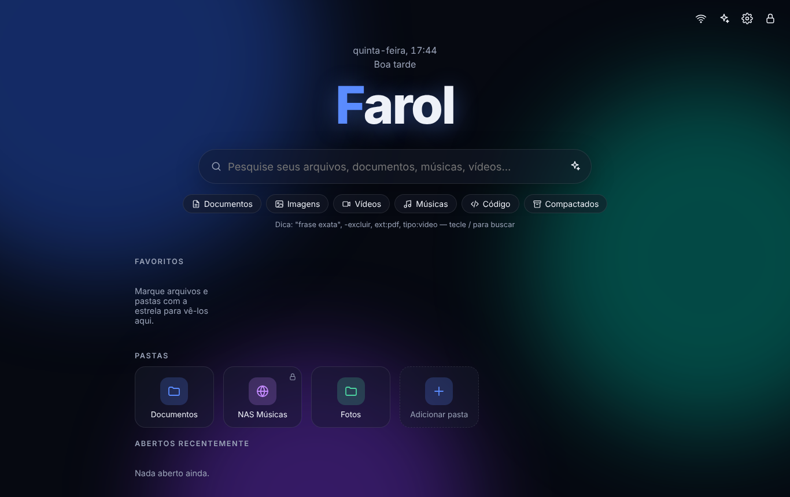
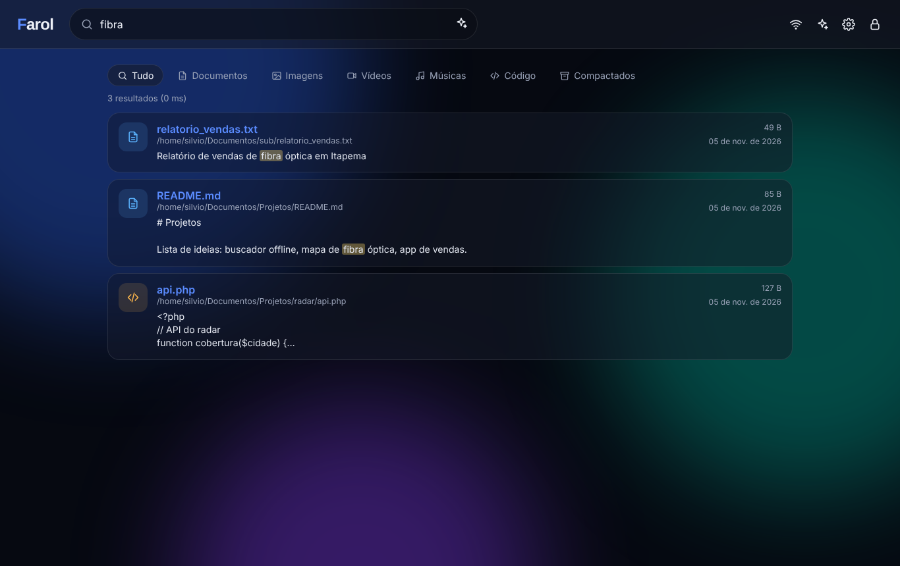

<h1 align="center">Farol</h1>

<b>Tu "Google" offline: busca, abre, reproduce y edita todo lo que hay en tu computadora — sin internet, sin nube, sin rastreo.</b>

<a href="README.md">🇧🇷 Português</a> · <a href="README.en.md">🇺🇸 English</a> · 🇪🇸 Español

 

## ✨ Funciones

- 🔎 **Búsqueda por nombre y por contenido** — TXT, MD, código fuente, PDF, DOCX, XLSX, PPTX, ODT, EPUB, HTML, CSV… Ignora acentos, fragmentos resaltados, resultados en milisegundos.
- 🧠 **Operadores estilo Google** — `"frase exacta"`, `-excluir`, `ext:pdf`, `tipo:video` / `tipo:musica` / `tipo:imagen` / `tipo:codigo`.
- 🎬 **Reproductor de video** con salto instantáneo · 🎵 **Reproductor de música** con cola, fijo abajo.
- 📄 **Visor** de PDF, imágenes (zoom) y textos de Office/LibreOffice · ✏️ **Editor de código fuente** (números de línea, Ctrl+S, copias de seguridad automáticas).
- ⭐ **Favoritos y recientes** en la pantalla de inicio.
- 🎨 **Totalmente personalizable** — tema claro/oscuro/automático, color de acento, fondos animados, **tu propia imagen de fondo**, color por carpeta, bloques vidrio/sólido/contorno, fuentes, densidad, nombre del logo y saludo.
- 🌐 **Carpetas de red** (SMB/NFS, NAS, `\\servidor\recurso`, unidades asignadas) con opción **solo lectura**.
- 📡 **Panel Red** — quién está **conectado a Farol** (IP, navegador, última actividad, desconectar) y los **dispositivos de tu red local** (IP, MAC, nombre, router).
- 🤖 **IA opcional** — **Claude**, **ChatGPT**, **Ollama (local, offline)**, LM Studio o cualquier API compatible con OpenAI. Busca en tus archivos y **cita las fuentes**.
- 🖥️ **Modo Dev (apagado por defecto)** — terminal en el navegador y conexiones **SSH** guardadas. Requiere la contraseña.
- 🌍 **3 idiomas** — Português, English, Español.
- 🔐 **Seguro** — contraseña definida en la instalación (sin contraseña por defecto), PBKDF2 600 mil iteraciones, bloqueo contra fuerza bruta, CSRF, CSP, sandbox de archivos.

## 🚀 Instalación

Único requisito: **Python 3.9+**.

| Sistema | Cómo |
|---|---|
| **Windows** | Descarga el ZIP → doble clic en `install.bat` → define tu contraseña → acceso directo "Farol" en el Escritorio |
| **Linux / macOS** | `./install.sh` y luego `./farol.sh` |
| **Servidor Linux (systemd)** | `sudo ./install.sh --server` — ver [docs/SERVIDOR.md](docs/SERVIDOR.md) para HTTPS |
| **Docker** | `FAROL_PASSWORD='claveFuerte' docker compose up -d` |
| **Manual** | `pip install -r requirements.txt && python -m farol setup && python -m farol run` |

## ⌨️ Atajos

`/` o `Ctrl+K` buscar · `Esc` cerrar · `Ctrl+S` guardar · `Espacio` reproducir/pausar

## 🤖 IA

Ollama y LM Studio funcionan 100% offline. Con Claude/ChatGPT solo se envían la pregunta y **fragmentos** de los archivos más relevantes. La clave de la API nunca vuelve al navegador.

## 📜 Licencia

[MIT](LICENSE)
