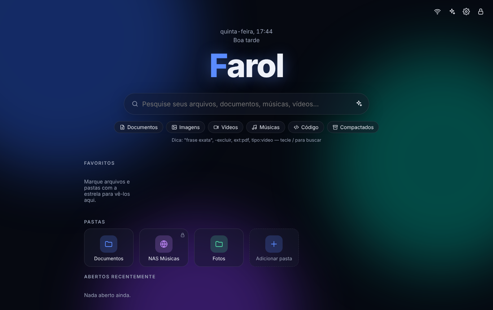
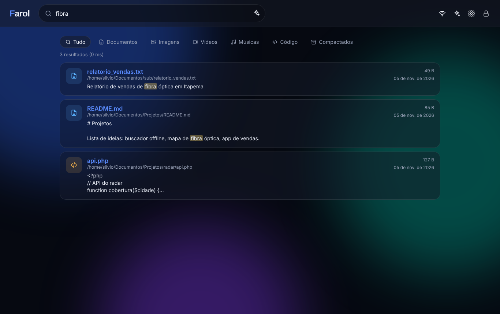
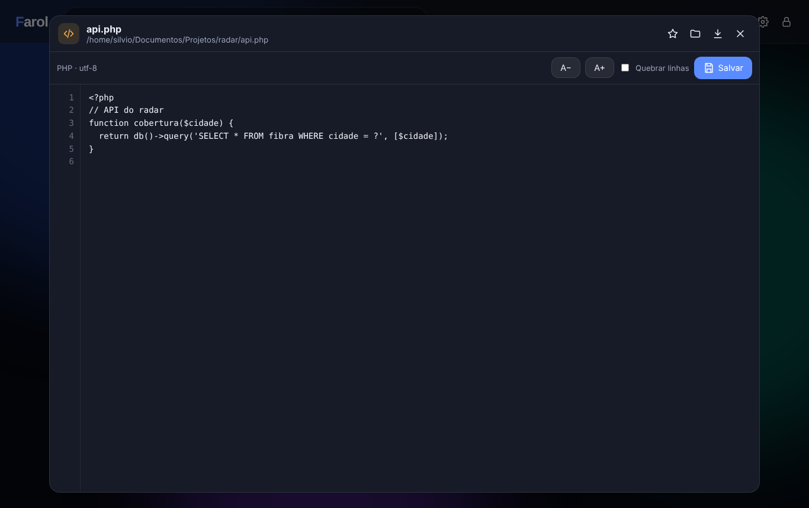
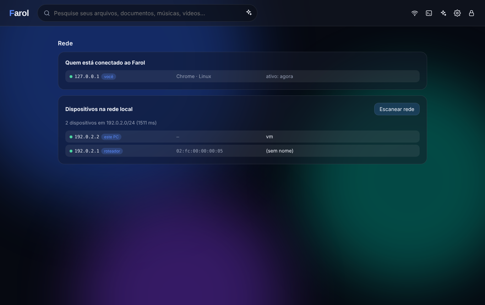
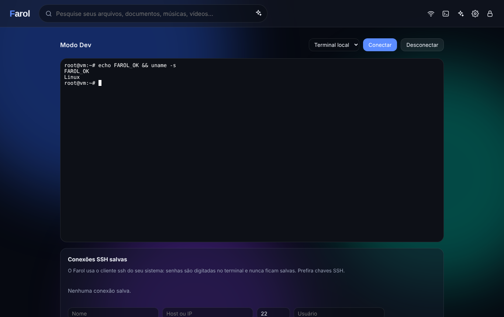

<p align="center"></p>

<h1 align="center">Farol</h1>
<p align="center"><b>Seu "Google" offline: busque, abra, toque e edite tudo o que está no seu computador — sem internet, sem nuvem, sem rastreio.</b></p>
<p align="center">🇧🇷 Português · <a href="README.en.md">🇺🇸 English</a> · <a href="README.es.md">🇪🇸 Español</a></p>

<p align="center">
  
  
  
  
</p>

<p align="center"> </p>
<p align="center">  </p>

\---

## ✨ O que ele faz

|||
|-|-|
|🔎 **Busca por nome e por conteúdo**|Acha palavras *dentro* de TXT, MD, código, PDF, DOCX, XLSX, PPTX, ODT, EPUB, HTML, CSV… Ignora acentos ("optica" acha "óptica"). Resultados com trecho destacado, em milissegundos.|
|🧠 **Operadores estilo Google**|`"frase exata"` · `-excluir` · `ext:pdf` · `tipo:video` / `tipo:musica` / `tipo:imagem` / `tipo:codigo`|
|🎬 **Player de vídeo**|MP4, WEBM, MOV, MKV\* com avanço/retrocesso instantâneo (streaming com *Range*).|
|🎵 **Player de música**|Fila, próxima/anterior, volume, player fixo no rodapé enquanto você navega.|
|📄 **Visualizador**|PDF, imagens (com zoom), texto extraído de documentos do Office/LibreOffice.|
|✏️ **Editor de código-fonte**|Numeração de linhas, Ctrl+S, recuo com Tab, tamanho de fonte, quebra de linha. Backup automático de cada versão salva.|
|⭐ **Favoritos e recentes**|Arquivos e pastas na tela inicial, como os atalhos de um navegador.|
|🎨 **Totalmente personalizável**|Tema claro/escuro/automático, cor de destaque, fundos animados, **sua própria imagem de fundo**, cor de cada pasta, estilo vidro/sólido/contorno, fonte, densidade, nome do "logo" e saudação.|
|🌐 **Pastas de rede**|Compartilhamentos SMB/NFS, NAS, `\\\\servidor\\pasta`, unidades mapeadas — com opção **somente leitura**.|
|📡 **Painel Rede**|Mostra **quem está conectado ao Farol** (IP, navegador, último acesso — e permite desconectar) e **os dispositivos ativos na sua rede local** (IP, MAC, nome, roteador).|
|🤖 **IA opcional**|Conecte **Claude**, **ChatGPT**, **Ollama (IA local, offline)**, LM Studio ou qualquer API compatível. A IA pesquisa nos seus arquivos e responde **citando as fontes**.|
|🖥️ **Modo Dev (desligado por padrão)**|Terminal no navegador (shell local) e **conexões SSH** salvas. Só liga com a senha.|
|🌍 **3 idiomas**|Português, English, Español — na interface e no instalador.|
|🔐 **Seguro**|Senha definida na instalação, PBKDF2 600 mil iterações, bloqueio contra força bruta, proteção CSRF, CSP, sandbox de arquivos, sem acesso fora das pastas cadastradas.|

\* MKV/AVI dependem do suporte do navegador.

\---

## 🚀 Instalação

Requisito único: **Python 3.9+** (o instalador avisa se faltar).

### Windows

1. Baixe o projeto (botão **Code → Download ZIP**) e extraia.
2. Dê **duplo clique em `install.bat`**.
3. Escolha idioma, modo, pastas e **defina sua senha**.
4. Pronto: atalho **Farol** na Área de Trabalho.

> Para pastas de rede use `\\\\servidor\\compartilhamento` ou uma unidade mapeada (`Z:\\`).

### Linux e macOS

```bash
git clone https://github.com/sdalberto/farol.git
cd farol
./install.sh          # pergunta idioma, pastas e SENHA
./farol.sh            # abre no navegador
```

### Linux Server (serviço systemd, acesso pela rede)

```bash
sudo ./install.sh --server            # porta padrão 8765  (--port=9000 para mudar)
```

Cria o usuário de sistema `farol`, instala em `/opt/farol`, guarda os dados em `/var/lib/farol`, pede a **senha** e liga o serviço com endurecimento de segurança. Veja [**docs/SERVIDOR.md**](docs/SERVIDOR.md) para HTTPS.

### Docker

```bash
FAROL\_PASSWORD='suaSenhaForte' docker compose up -d
```

Monte as pastas que quer pesquisar em `/media/...` (veja `docker-compose.yml`).

### Manual (qualquer sistema)

```bash
python -m venv .venv \&\& . .venv/bin/activate      # Windows: .venv\\Scripts\\activate
pip install -r requirements.txt
python -m farol setup      # define a senha
python -m farol run
```

\---

## ⌨️ Atalhos

|Tecla|Ação|
|-|-|
|`/` ou `Ctrl+K`|Ir para a busca|
|`Esc`|Fechar visualizador / painéis|
|`Ctrl+S`|Salvar no editor|
|`Espaço`|Tocar/pausar música|

## 🛠️ Linha de comando

```bash
python -m farol setup \[--server] \[--lang pt-BR|en|es] \[--root PASTA] \[--port N] \[--password-stdin]
python -m farol run \[--no-browser] \[--cert cert.pem --key key.pem] \[--proxy]
python -m farol passwd              # trocar senha
python -m farol add-root PASTA \[--readonly]
python -m farol index               # indexar agora
python -m farol dev --on|--off      # Modo Dev
```

## 🤖 Conectando uma IA

**Configurações → IA**:

|Provedor|O que preencher|Offline?|
|-|-|-|
|**Ollama**|Instale o [Ollama](https://ollama.com), rode `ollama pull llama3.1` e escolha o modelo|✅ Sim|
|**LM Studio / llama.cpp**|"Compatível OpenAI" + URL `http://127.0.0.1:1234/v1`|✅ Sim|
|**Claude**|Chave da API da Anthropic + modelo|❌ Nuvem|
|**ChatGPT**|Chave da API da OpenAI + modelo|❌ Nuvem|
|**Outros** (OpenRouter, Groq, Gemini…)|"Compatível OpenAI" + URL + chave|❌ Nuvem|

Com provedores na nuvem, só a pergunta e **trechos** dos arquivos mais relevantes são enviados. A chave da API fica só no seu computador e nunca volta para o navegador.

## 🔐 Segurança

* **Não existe senha padrão** — você define na instalação.
* Senha guardada só como hash **PBKDF2-SHA256 (600 mil iterações)**; arquivo de configuração com permissão `600`.
* Bloqueio progressivo após 5 tentativas erradas.
* Cookies `HttpOnly` + `SameSite=Strict`, cabeçalho anti-CSRF obrigatório, CSP restritiva.
* O Farol só abre arquivos **dentro das pastas cadastradas** (links simbólicos para fora são bloqueados).
* Arquivos HTML/SVG das suas pastas são exibidos como texto, com *sandbox* — não executam script.
* No modo desktop escuta apenas em `127.0.0.1` (ninguém da rede acessa).
* **Modo Dev** desligado por padrão, exige a senha para ligar e pode ser bloqueado de vez com `FAROL\_DISABLE\_DEV=1`.

Encontrou uma falha? Veja [SECURITY.md](SECURITY.md).

## 🧩 Arquitetura

```
farol/
├── \_\_main\_\_.py     # linha de comando (setup, run, passwd…) em 3 idiomas
├── config.py       # configuração persistente (JSON)
├── security.py     # senha, sessões, limite de tentativas, validação de caminhos
├── extractors.py   # extração de texto (PDF, Office, ODF, EPUB, código…)
├── indexer.py      # indexador incremental + busca SQLite FTS5 (BM25)
├── server.py       # API FastAPI + streaming + WebSocket do terminal
├── ai.py           # conectores de IA (Claude, OpenAI, Ollama, compatíveis)
├── devterm.py      # Modo Dev: PTY local e SSH
├── netscan.py      # painel Rede: dispositivos da LAN
└── static/         # interface (HTML/CSS/JS puro, sem CDN) + i18n + xterm.js
```

Todo o código está **comentado em português** para facilitar contribuições. Veja [CONTRIBUTING.md](CONTRIBUTING.md).

## 🗺️ Ideias para o futuro

* Miniaturas de vídeo e capas de álbum (ffmpeg opcional)
* OCR de imagens e PDFs escaneados (Tesseract opcional)
* Busca semântica com embeddings locais
* App de bandeja (system tray) e empacotamento em executável
* Realce de sintaxe no editor

## 📜 Licença

[MIT](LICENSE) — livre para usar, modificar e distribuir.

